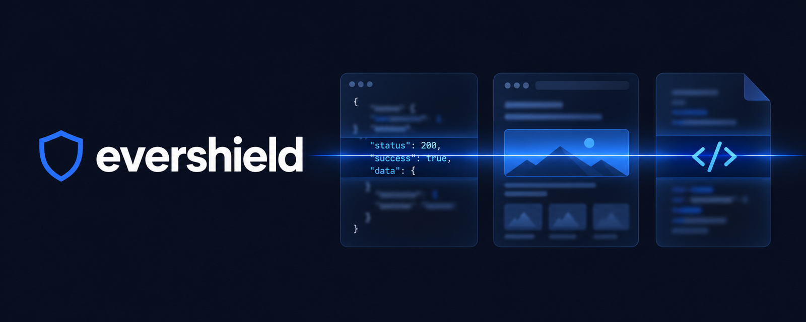

<p align="center">
  
</p>

# evershield

**Your paywall is probably just CSS.** evershield checks what each plan's
users actually receive, in the API response and in the page, and fails the
build when a free user is holding your Pro data.

```bash
npx evershield demo      # 30 seconds, no config: a built-in app whose paywall only blurs
```

```
━━ Layer 3 · what the free user's page holds but cannot see
✖ [high/high] /: "Burstiness score 0.82 (human-like)" is visible to pro and present but hidden for free (text hidden by blur)
━━ Layer 2 · what the free user's API response carries
✖ [high/high] GET /api/report returns "burstiness" to free, which the config says must not receive it
━━ Layer 1 · what the shipped bundle gives away
✖ [critical/high] Stripe secret key shipped in assets/main.js

The paywall was CSS; the data was already in the free user's hands.
```

`npx evershield demo --fixed` runs the same app after the fixes and reports
nothing. Layer 3 needs Playwright (`npm install playwright && npx playwright
install chromium`); without it the demo shows layers 1 and 2.

> Status: pre-release. All three layers work. Follow the
> [roadmap](docs/design.md#roadmap) or open an issue to help shape it.

## Why

A common way to build a paid tier: the API returns the full object, and the
client decides what to show. Free users get the numbers blurred, a lock icon
over a card, a `display: none` on the Pro section. It looks locked. It is
not: the values are in the response and in the DOM, one DevTools tab away,
and agent tools that reverse engineer web apps now read them automatically.

This is how evershield started. A side project of mine showed a "Pro only"
metric blurred in the UI while the real number was in every free user's
JSON. No secret scanner would ever flag that: nothing secret-shaped leaked,
just data the wrong tier could read.

evershield checks three places, before deploy:

| Layer | Command | What it catches | Example |
|---|---|---|---|
| **3 · Surface** | `surface` | data hidden by CSS instead of withheld by the server | a blurred paywall with the real numbers in the DOM |
| **2 · Response** | `audit` | higher-tier data in lower-tier API responses | "Pro only" metrics in every free user's JSON |
| **1 · Artifact** | `scan` | keys, internal URLs, source maps in the build | a billing key in the bundle, a published `.map` |

The order matches the demo: from what the user sees, down to what the bundle
ships. Rule IDs carry the layer name (`surface/…`, `response/…`,
`artifact/…`); commands carry the verb.

Layers 2 and 3 call your own app as each identity you configure (anonymous,
free, pro, ...) and compare what each one gets. Layer 1 overlaps with secret
scanners such as gitleaks, which can also scan a build directory; run both.
What evershield adds there is build-aware filtering (only browser-facing
Next.js files, app packages such as `.apk` and `.ipa`) and the same report,
gate and SARIF output as the other two layers.

## Get started

```bash
npx evershield init              # writes evershield.config.json and a GitHub workflow
npm run build
npx evershield scan ./dist       # ./.next for Next.js; exit 0 means nothing blocking
```

New to it? [Your first evershield run](docs/tutorial.md) takes about ten
minutes, from the demo to a passing check on your own build.

## Guides

| I want to | Guide |
|---|---|
| fail CI when a free user receives Pro fields | [Audit API responses](docs/how-to/audit-api-responses.md) |
| find Pro content hidden by CSS in the free page | [Find cosmetic paywalls](docs/how-to/find-cosmetic-paywalls.md) |
| check a build or `.apk`/`.ipa`/`.asar` for keys and source maps | [Scan the build](docs/how-to/scan-the-build.md) |
| see what a reverse-engineering tool gets from my app | [Check what reverse engineers get](docs/how-to/check-what-reverse-engineers-get.md) |
| run it on every pull request | [Run in CI](docs/how-to/run-in-ci.md) |
| let Claude Code, Cursor or Codex run it while coding | [Use from a coding agent](docs/how-to/use-with-coding-agents.md) |
| silence a known-safe match | [Allowlist a finding](docs/how-to/allowlist-a-finding.md) |

Reference: [CLI and Action](docs/reference/cli.md) · [rules](docs/rules.md) ·
[configuration](docs/configuration.md). All docs: [docs/](docs/README.md).

## Measured on real code

Every rule change runs against a [false-positive corpus](docs/corpus.md): 42
pinned npm packages that ship to browsers (React, Vue, Firebase, Supabase,
Auth0, Sentry, Stripe.js, PostHog, three.js, pdf.js and more) plus 10 default
apps from Next.js, Vite, SvelteKit, Astro and Expo (Hermes bytecode)
generators, built as deployed. **False positives at the default gate: 0**
across 8,886 files and 175 MiB.
The one blocking finding is a true positive (a development build with an
inline source map). The first run found 8 false positives, all in
auth0-spa-js; fixing them is how the rules got here.

## Tested against REA

[experiments/rea](experiments/rea/README.md) points
[REA](https://github.com/morluto/rea) at a deliberately leaky app and at the
same app fixed with evershield. REA recovered all five leaks from the leaky
build (a secret key, an internal address, source via source maps, blurred
Pro data in the DOM, Pro fields in a free response); evershield flagged all
five; after the fix REA recovered none and evershield reported nothing.
evershield does not hide your app from REA. It makes sure there is nothing
in it worth taking, and `evershield recon --rea` checks that against REA
itself on every build.

## Principles

- **Defensive only.** It audits targets you own, listed in your config.
- **Local only.** Nothing leaves your machine. No telemetry.
- **Evidence first.** Every finding has a location and a confidence. Noise is
  a bug.
- **Framework agnostic.** Files and HTTP responses, whatever produced them.
- **CI first.** Stable exit codes, JSON and SARIF output.

Background: [design document](docs/design.md).

## Contributing

See [CONTRIBUTING.md](CONTRIBUTING.md). Security reports: see
[SECURITY.md](SECURITY.md).

## License

[MIT](LICENSE)
